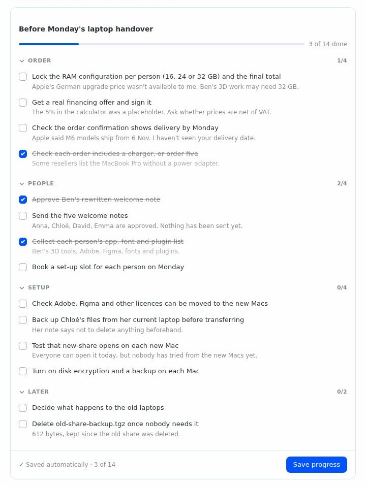

# HUI+ Cards for Hermes

Hermes answers with cards you act on — tick, compare, fill in, approve — right in the Hermes Desktop chat; each click is the next message.

<!-- Screenshots are added later. -->
<p>
  
  
  
</p>

## Install

Requires Hermes 0.22.6 or newer.

**From the plugin catalog** (once the plugin is listed there):

```bash
hermes plugins install hermes-ui-cards
```

**From GitHub:**

```bash
hermes plugins install robbyczgw-cla/hermes-ui-cards
```

Hermes asks `Enable 'hermes-ui-cards' now? [y/N]`. Answer `y`, or add `--enable` to the command. To enable it later:

```bash
hermes plugins enable hermes-ui-cards
```

Start a new chat afterwards so the `hui_present` tool is loaded.

**Turn on the Desktop half.** The plugin has two halves: the agent half (tool, command, skill) and the Desktop half that draws the cards. Hermes Desktop copies the Desktop half when the package is installed, but it is opt-in. Open **Capabilities → Plugins**, find *HUI+ Cards* and switch on the **Desktop** column. Without it, Desktop shows each card as a Markdown attachment (see [Other surfaces](#other-surfaces)).

**One-click link** (Hermes Desktop opens a confirmation dialog; nothing is installed until you confirm):

```
hermes://plugin/install?repo=robbyczgw-cla/hermes-ui-cards&enable=1
```

## Cards

Ten card types. The first five are the ones to reach for.

| Type | What the user does | What Hermes gets back |
|---|---|---|
| `checklist` | Ticks items off. Ticks are saved. Presses Done. | `done` and `open` item texts |
| `compare` | Reads 2–4 candidates side by side and picks one. | The picked column (`selected`, `label`) |
| `form` | Fills in text, number, date, time, email, select and toggle fields. | `values`: field name → value |
| `steps` | Works through a walkthrough with Back/Next. Reports done or stuck. | `completed` with the step count, or the step number and title where the user got stuck |
| `confirm` | Reads one action with reason, risk and command. Answers Yes, No or Change. | `decision`: `yes`, `no` or `change`, plus the change text |
| `choice` | Picks one or several of 2–6 options, with pictures or a short text per option, optionally an "Other" field. | `selected` option ids and `labels`, plus `other` |
| `schedule` | Picks one or several time slots, or "none of these". | The chosen slots, or `none` |
| `rating` | Rates on a scale of stars or numbers, optionally with a comment. | `value`, `scale`, `comment` |
| `slider` | Sets one number in a range. | `value` and `unit` |
| `quiz` | Answers multiple-choice questions and sees feedback per answer. | `score`, `total` and each answer |

For a plain single question with a few simple options, Hermes' built-in `clarify` picker is the right tool. Use `choice` when you need several picks, pictures or a short text per option.

Try them with `/cards demo checklist` (any type works) or ask Hermes: "Show me the hui_present demo for compare".

## How it works

1. Hermes calls the `hui_present` tool with one card. The tool checks the card. If a field is wrong, the tool returns an error that names each bad field, and Hermes fixes it.
2. On Desktop, the tool result carries the card. The Desktop half draws it inline in the chat.
3. A click sends one message to the same chat, as if you had typed it. Line 1 is for people, line 2 is for the model:

   ```
   ✓ Chose: Spa
   [hui-card] {"card":"trip-style-3f9a1c","type":"choice","selected":["o3"],"labels":["Spa"]}
   ```

4. Hermes reads the `[hui-card]` line and reacts.

More behavior:

- An answered card shows its answer and cannot be sent twice.
- Checklist ticks and form drafts are saved. They survive reopening the chat and restarting the app.
- If the card's chat is no longer active, the card says "This chat is no longer active" instead of showing a dead button.
- Safety net: the card travels as a `MEDIA:` line in Hermes' reply. If the model forgets that line, the `transform_llm_output` hook appends it, so the card still appears.

The full message format and the answer fields of every type are in [docs/protocol.md](docs/protocol.md).

## Other surfaces

The CLI, TUI, Telegram, Discord and other messaging platforms, and the API server get a plain-text version of the card. The user answers by typing a number or words, and Hermes maps the reply to the options.

Checklist:

```
Before the release

Code
☐ 1. Bump the version
☐ 2. Update the changelog
☑ 3. Run the full test suite

Comms
☐ 4. Write the announcement
☐ 5. Tell support about the changes
Reply with the numbers you have done, e.g. 1, 4.
```

Confirm:

```
Delete old log files?
Action: Delete 14 log files older than 30 days in ~/logs
Why: They use 2.3 GB and nothing reads them
Risk (medium): Deleted files can't be restored
Command:
  find ~/logs -name '*.log' -mtime +30 -delete
Reply yes, no, or what to change.
```

Hermes Desktop without the Desktop half enabled shows the card as a Markdown attachment: the same text, as a file.

Web dashboard: the plugin only draws cards when the chat reports the platform `desktop`. Any other chat gets the text version. The dashboard has not been tested.

## Settings

Open **Settings → Plugins → hermes-ui-cards**.

| Key | Default | Meaning |
|---|---|---|
| `enabled` | on | Interactive cards. Off: Desktop also gets the text version. |
| `compact` | off | Less padding and smaller images, for narrow split views. |
| `accent` | `app` | `app`, `blue`, `green`, `orange`, `purple` or `red`. `app` follows the accent of your Desktop theme. |

Commands:

- `/cards` shows the status: version, on or off, the card types.
- `/cards types` lists the types with a one-line description.
- `/cards demo <type>` shows an example card as text (default `checklist`).

Desktop palette (⌘K / Ctrl+K): **HUI+ Cards: show an example card** sends the checklist demo prompt to the focused chat.

## Limits

- Card state (answers, checklist ticks, form drafts) is stored per computer in the Desktop plugin storage. It is not synced between computers. The newest 300 cards are kept.
- One card per tool call.
- Cards render in Hermes Desktop only. Other surfaces get text.
- Images load from `https` URLs that the model got from a tool or the user. Desktop fetches them.
- With `plugins.isolation: host`, Desktop detection is untested.
- A card answer is a chat message. It does not bypass approvals: when a command needs Hermes' approval, Hermes still asks.

## Privacy

- The plugin makes no network requests of its own, sends no telemetry and needs no secrets.
- It writes a text copy of each Desktop card to `<HERMES_HOME>/plugin-data/hermes-ui-cards/cards/`. The newest 500 files are kept.
- Desktop stores answers, ticks and drafts in its plugin storage on your computer.
- Images on a card are fetched by Desktop from the URL on the card.

## Development

```bash
python3 scripts/build.py            # regenerate desktop/plugin.js and desktop/cards.d.ts
python3 scripts/build.py --check    # fail if the generated files are out of date

python3 -m venv .venv && .venv/bin/pip install pytest
.venv/bin/python -m pytest --rootdir=tests tests    # Python tests
npm install && npm test                             # Desktop tests (jsdom)

hermes plugins validate .
```

- `hui_cards/cards.schema.json` is the single source for card shapes. The Python validator reads it, and `scripts/build.py` embeds it in the Desktop half and generates the TypeScript types.
- `desktop/src/*.js` are the sources of the Desktop half. `desktop/plugin.js` is generated: do not edit it by hand.
- `tests/e2e` holds a mock LLM for end-to-end runs.

## Related

- Works alongside `hermes-rich-ui`, which shows display cards: tables and charts. HUI+ Cards is for cards you answer.
- The card format is credited to the Hermes UI+ app (MIT).

## License

MIT, see [LICENSE](LICENSE). Changes are listed in [CHANGELOG.md](CHANGELOG.md).
