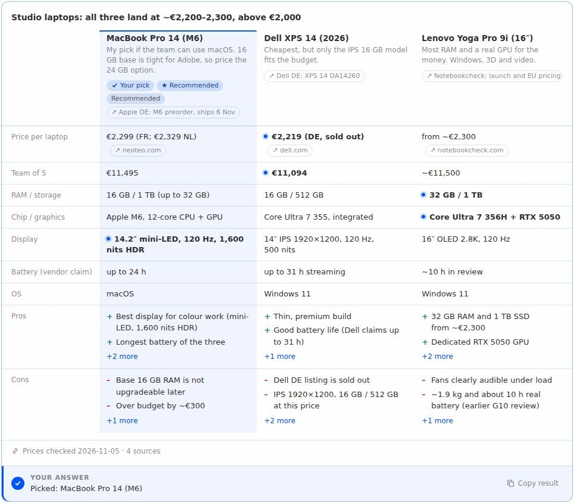
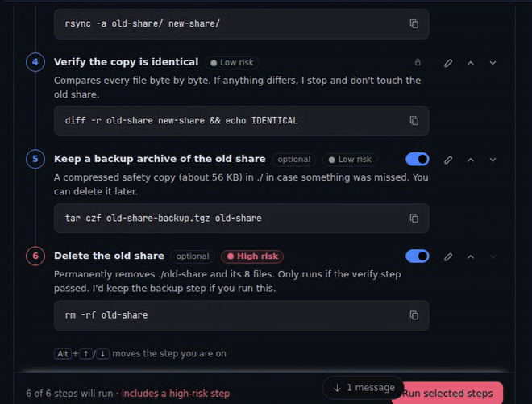
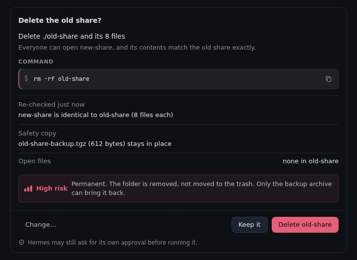

# HUI+ Cards for Hermes

Hermes answers with cards you act on in its chat (edit a plan, compare options, tick off a list, fill in
a form, approve a risky step), and when you submit one, your answer goes back as your next message.



<p>
  
  
</p>

<!-- DEMO VIDEO LINK -->

## Install

Requires **Hermes 0.22.6 or newer** (the version that lets a plugin draw the files its own tool
produces).

1. Install and enable the plugin:

   ```bash
   hermes plugins install robbyczgw-cla/hermes-ui-cards --enable
   ```

   Once it is listed in the plugin catalog, `hermes plugins install hermes-ui-cards --enable` works
   too. Or use the install link: `hermes://plugin/install?repo=robbyczgw-cla/hermes-ui-cards&enable=1`.

2. **Check that the Desktop half is on.** Desktop plugins are opt-in: after a CLI install, open
   **Capabilities → Plugins** in Hermes Desktop (or the Hermes Webapp), find *HUI+ Cards* and switch on
   its **Desktop** half. (Installing through the link above or the Desktop's own install dialog turns
   it on for you.) Without it, each card shows up as a small Markdown file attachment instead of a card.

   With a remote backend the Desktop half is not copied from the server: install it from Git in the
   Desktop's plugin dialog with the Desktop target checked.

3. Start a new chat. Try `Show me the hui_present demo for plan`, or just ask for something that
   needs a decision ("help me pack for Japan in January", "migrate the blog to the new server").

## Cards

17 card types. Use the built-in `clarify` picker for a single plain question with a few simple options.

| Card | What you do | What Hermes gets |
|---|---|---|
| `checklist` | Tick items off; ticks are saved as you go | Done and open items |
| `compare` | Read 2–4 options side by side, pick one | Your pick |
| `form` | Fill in fields with required ones and checks | The values |
| `steps` | Follow a walkthrough with Back and Next; say when you're done or stuck | Done, or where you got stuck and why |
| `confirm` | Read one action with its reason, risk and exact command; Yes, No or Change | Your decision, or what to change |
| `plan` | Switch off optional steps, reorder, add a note per step, then Run | The steps to run, in your order, with notes |
| `review` | Keep or drop many drafts at once, comment on any | Which to keep, drop or leave open, plus comments |
| `decision` | Weigh criteria with sliders; the ranking updates live | Your weights and the ranking, or a pick |
| `calc` | Change inputs; results update live (loan, budget, split a bill) | Inputs and results |
| `rank` | Put items in order (drag or Alt+↑/↓) | The order |
| `choice` | Pick several options, or options with a picture or short text each | Your picks |
| `schedule` | Pick a time slot, or "none of these" | The slot |
| `recipe` | Scale servings, tick what you have | A shopping list for what's missing |
| `flashcards` | Flip cards, mark known or again | What you knew and what to practise |
| `rating`, `slider`, `quiz` | Rate, set one number, answer practice questions | The rating, the number, your score |

Most replies are still plain text.

## How it works

1. Hermes calls the `hui_present` tool with one card. The tool checks it against
   [one schema](hui_cards/cards.schema.json): a missing or broken field is rejected with an error that
   names it, so the model can fix it; small slips (an unknown field, `"true"` for `true`) are accepted
   with a warning.
2. On Desktop the tool result carries the card, and the plugin's Desktop half draws it in the chat.
3. Submitting the card (Send, Done, Choose, Run, Apply, Yes/No) sends one message into the same chat,
   as if you had typed it. Ticking, typing and navigating inside a card send nothing:

   ```
   ✓ Picked: MacBook Pro 14 (M6)

   --- Attached Context ---

   [hui-card] {"card":"laptops-3f9a1c2b7e","type":"compare","selected":"c1","label":"MacBook Pro 14 (M6)"}
   ```

   Line 1 is for you, the `[hui-card]` line is for the model. It follows Hermes' own attached-context
   line, so the chat bubble shows the whole message while the reply is being written and collapses to
   line 1 once the reply is done (and after reopening the chat). The full format is in
   [docs/protocol.md](docs/protocol.md).

Details that make it dependable:

- **Answered cards lock.** An answered card shows a receipt and locks in that window. The plugin's
  backend records answers too, so the Webapp, the Desktop app and a second computer on the same Hermes
  lock the card once they have checked (its buttons wait for that first check). This is eventual, not
  exactly-once: two clients that answer before either has synced can both send; the backend keeps the
  first answer and tells the model about the second.
- **Undo before it counts.** A pick on `compare`, Run on `plan`, Apply on `review` and Yes on a medium-
  or high-risk `confirm` wait 4 seconds (Settings: 0, 4 or 8) and can be undone. The countdown ticks
  down on screen; screen readers hear the starting value once.
- **A card is not an approval bypass.** A Yes on a card is your message to the model. Hermes' own
  approval settings still apply to whatever it then runs (with the default *Smart* approval mode, Hermes
  may approve routine commands itself, so the card is often the only question you see).
- **Work in progress is kept.** Checklist ticks, form input and drafts survive reopening the chat.
- **Stale answers are flagged.** If you answer a card after writing other messages, the model is told
  to check that the answer still fits and to ask again before acting on a stale confirm (a warning to
  the model, not an enforced lock).
- **The card is shown even if the model forgets.** If the reply lacks the card's line, the plugin adds
  it (for cards of that chat from the last 30 minutes).
- **Plugin tools are found.** Hermes hides plugin tools behind its tool search by default; on Desktop
  the plugin adds a one-line hint so the model knows cards exist. Hermes keeps it with that message,
  so it is added again only when none of the last 20 messages carries it (or its text changed).

## Fallback and other surfaces

| Where | What you get |
|---|---|
| Hermes Desktop, Hermes Webapp | Interactive cards |
| CLI, TUI, Telegram, Discord, other messaging, web dashboard chat | A plain-text version with numbered options; you answer by typing |
| Hermes API server with the [Hermes UI+](https://github.com/robbyczgw-cla/hermes-ui-plus) app | The app's own cards for the supported variants of 12 types ([details](hui_cards/hui_blocks.py)); plan, review, compare, recipe and flashcards always as text. Answers use the app's reply format; the Desktop's undo and receipts don't carry over |
| Desktop with the Desktop half switched off | The text version as a Markdown attachment |
| Desktop with *Interactive cards* switched off | The text version, for cards created after the switch |

The text version of the checklist demo:

```
Before the release

Code
☐ 1. Bump the version
☐ 2. Update the changelog
☑ 3. Run the full test suite

Comms
☐ 4. Write the announcement
☐ 5. Tell support about the changes

Reply with the numbers you have done, e.g. 1, 4.
```

## Settings

**Settings → Plugins → hermes-ui-cards.** Compact, accent colour and undo time apply to cards already on
screen; the other settings affect cards created afterwards.

| Setting | Default | Meaning |
|---|---|---|
| Interactive cards | on | Off: new cards in Desktop come as text too |
| Compact cards | off | Less padding, for narrow split views |
| Accent colour | app | Your theme's accent, or blue, green, orange, purple, red |
| Undo time (seconds) | 4 | 0, 4 or 8 seconds before a pick, Run, Apply or risky Yes is sent |
| Card types | all 17 | The types Hermes may use; disabled types are refused immediately; an empty list means all (the tool description follows after a Hermes restart) |
| Cards for the Hermes UI+ app | auto | API server format: auto uses native cards when the app plugin is enabled; `hui` always requests them; `text` uses text |

Commands: `/cards` (status), `/cards types`, `/cards demo <type>` (the text version of a demo card).
In Desktop, the command palette has *HUI+ Cards: show an example card*.

## Limits

- Interactive cards render in Hermes Desktop and the Hermes Webapp (and, for some types, in the Hermes
  UI+ app); everything else gets text.
- One card per tool call; a card is at most 24,000 bytes, an answer at most 4,000 characters (the
  [protocol](docs/protocol.md) lists the field limits).
- Answer synchronization between devices is eventual (see above), and it follows the backend the window
  is connected to: in a split view with chats of different profiles or backends, cards of the inactive
  one are not synchronized.
- Tested against Hermes 0.22.7; 0.22.6 is the first version with the APIs the plugin needs, but it was
  not run here.
- With `plugins.isolation: host`, Desktop detection and the backend routes are untested.
- Card images are loaded from the `https` URLs the model puts on the card (it is told to use only URLs
  it got from a tool or from you).

## Privacy and what the plugin stores

No telemetry or usage reporting, no credentials read or stored, no shell commands run by the plugin.
Card answers and temporary card context go through Hermes to its configured model provider like any
other message; images on cards are fetched by your Desktop directly from their hosts. What is stored
and sent:

**On the Hermes host**, per profile, in `<HERMES_HOME>/plugin-data/hermes-ui-cards/`:
- `answers.db` (SQLite): for each card shown on Desktop, its id, type, the chat that showed it, verified
  branches and when it was shown; each answer (up to 8 chats per card): the mark, line 1 (up to 300
  characters) and the answer data, including free text you typed into the card (form values, comments,
  notes), up to 20,000 bytes; and the compaction links Hermes reports (up to 5,000). The 2,000 most
  recently shown or answered cards are kept; reading doesn't refresh that, there is no time-based
  expiry, and deleting a chat does not delete its entries.
- `cards/<id>.md`: the text version of each Desktop card plus the card itself (for a confirm card,
  also its action and command). The newest 500 are kept.

**To the model provider**, as context added to the turn that answers a card: the card's type, title
and id, for a confirm card its action and command, and notes when the answer is stale or a duplicate.
On Desktop, a one-line hint that cards exist (on the first turn, then when no message of the last 20
carries it). Hermes stores this context with the user message in its session database and sends it
again with that message in later turns, like the message itself.

**Backend routes** (read-only, under `/api/plugins/hermes-ui-cards/`, behind Hermes' own sign-in):
`GET /answers` returns the answers of one chat's cards to any client signed in to that backend that
knows the chat and card ids; `GET /settings` returns the display settings. After each recorded answer
the plugin broadcasts an empty `answers.changed` event so open windows check again.

**Reads outside its own data:** the active profile's Hermes configuration (its own settings and whether
the Hermes UI+ plugin is enabled) through Hermes' public config API, and non-secret session context
(platform, session id).

**On your computer**, in the Desktop's plugin storage: drafts (up to 300, including text never sent)
and receipts (up to 5,000), keyed by the active connection, profile and chat; the caps are shared by all
profiles of that Desktop; nothing expires by time.

**Network requests from the Desktop half** go only to the backend you are connected to, plus card
images, which your Desktop loads directly from the image host (that host sees your IP address).

## Development

```bash
python3 scripts/build.py            # regenerate desktop/plugin.js and desktop/cards.d.ts
python3 scripts/build.py --check    # fail if they are out of date

python3 -m venv .venv && .venv/bin/pip install pytest pyyaml
timeout 300 .venv/bin/python -m pytest tests -q   # Python: schema, tool, hooks, backend, calc parity
npm install && npm test                            # Desktop: jsdom, capped at 300 s and 1 GB

HERMES_BIN=/path/to/hermes python3 tests/e2e/run_e2e.py   # real Hermes + a scripted model
hermes plugins validate .
```

- `hui_cards/cards.schema.json` is the single source of card shapes: the Python validator reads it,
  `scripts/build.py` embeds it in the Desktop half (whose validator gives identical results on every
  test fixture) and generates `desktop/cards.d.ts`. The `calc` expression parser and evaluator also
  have a seeded parity test over generated expressions.
- `desktop/src/*.js` are the Desktop sources; `desktop/plugin.js` is generated.
- `calc` formulas are parsed by a small expression parser in both languages; nothing is evaluated
  with `eval`.

## Related

- [hermes-rich-ui](https://github.com/jacobhausler/hermes-rich-ui) draws display cards (tables,
  charts, metrics). HUI+ Cards is for cards you answer; the two work side by side.
- The card format comes from the [Hermes UI+](https://github.com/robbyczgw-cla/hermes-ui-plus) app (MIT).

## License

MIT, see [LICENSE](LICENSE). Changes are listed in [CHANGELOG.md](CHANGELOG.md).
